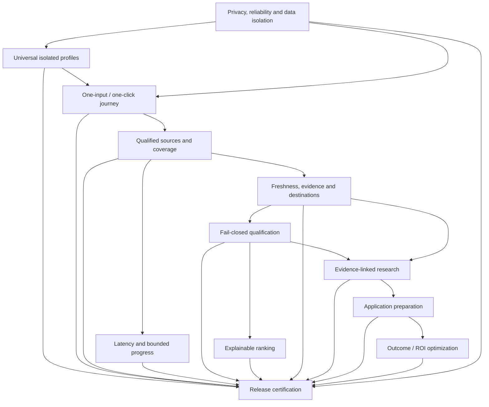

# JobBot production readiness

**Release decision: NOT PRODUCTION READY.** This document is a baseline and acceptance contract, not a certification.

## Exact baseline and evidence limits

| Field | Value |
|---|---|
| Repository | `kimhw8084/jobbot` |
| Target branch at inspection | `main` |
| Main commit | [`8d193e200254e42af03c22b923137ef9a1ccb83d`](https://github.com/kimhw8084/jobbot/commit/8d193e200254e42af03c22b923137ef9a1ccb83d) |
| Main tree | [`338e1b47f437baf38e3f605a1c4c7f2d484e31ca`](https://github.com/kimhw8084/jobbot/tree/8d193e200254e42af03c22b923137ef9a1ccb83d) |
| Source inspected | README; architecture, safety, database, operations, acceptance, search-plan, career-strategy, search-quality and troubleshooting docs; configuration loader and CLI; Bright Data adapter; release builder |
| Current-main test status | **UNKNOWN** — no deterministic suite was run against this exact main for this baseline. Historical candidate-branch test results do not transfer to main. |
| Live provider / UI / pilot status | **NOT RUN or UNVERIFIED** — the current baseline has no new live qualification, end-to-end UI, interruption-recovery, supported-platform, or pilot evidence. |

The repository source and the live JobBot Project Contract disagree about the selected Big-3 acquisition path. The README describes ordinary Chrome as the current route and managed acquisition as unselected; the current Project Contract selects managed/API acquisition, keeps Bright Data unqualified, and says `RUN_NOW` has not switched. CHG-275 owns reconciliation. This baseline records the conflict; it does not choose a new runtime path.

Status labels in the inventory mean:

- **IMPLEMENTED** — behavior exists in the inspected source. This does not imply current-main test or production qualification.
- **DOCUMENTED ONLY** — a requirement or design is described but the corresponding product behavior is not established in source or runtime evidence.
- **LEGACY/FROZEN** — retained compatibility behavior that is not the selected future production path.
- **PRODUCT GAP** — required user or system behavior is missing or materially unsafe.
- **EXTERNAL/UNVERIFIED** — proof depends on a provider, account, live site, platform, or pilot not qualified here.

## Current-state inventory

| Area | Status | Inspected evidence and limitation | Gates |
|---|---|---|---|
| Big-3 legacy browser acquisition | LEGACY/FROZEN | [README](../README.md), [Architecture](ARCHITECTURE.md), [Operations](OPERATIONS.md) and [Acceptance](ACCEPTANCE_TEST.md) describe Chrome/MV3/loopback; RUN NOW still invokes that path and requires a configured normal Chrome profile and extension. Historical receiver-loss runs did not meet their continuity targets ([JobBot Project](https://app.notion.com/p/3dbc564c8d04814c8564dcb97f8f05fc)). | G02–G04, G12 |
| Managed/API acquisition | EXTERNAL/UNVERIFIED | The [Bright Data adapter](../src/jobbot/acquisition/brightdata.py) exists behind `acquisition-v2`; the [CLI](../src/jobbot/cli.py) requires explicit live opt-in, a record cap and valid configuration. No current live qualification proves account schema, completeness, all-platform terminal semantics, coverage, cost or reliability. The [Project Contract](https://app.notion.com/p/3dbc564c8d04814c8564dcb97f8f05fc) and [source README](../README.md) disagree about selected direction; [CHG-275](https://app.notion.com/p/3e7c564c8d04811aa890e768b500d53c) owns the conflict. | G03–G04, G07, G11–G12 |
| Search plans and query provenance | IMPLEMENTED | [`live_search.toml`](../config/live_search.toml), [Search plan](SEARCH_PLAN.md) and [config loader](../src/jobbot/config.py) describe versioned query families, deterministic tasks, platform-specific passes and deep recall for enabled families. A plan is not proof that a live provider returned the configured universe. | G03–G04 |
| General-purpose isolated profiles | PRODUCT GAP | [`load_bundle()`](../src/jobbot/config.py) loads fixed strategy, live-search, candidate and runtime TOML files. There is no ordinary-user profile import/selection flow. Existing strategy/profile provenance is not data isolation for multiple job seekers. | G01–G02, G11 |
| One-input / one-click user flow | PRODUCT GAP | [`run-now`](../src/jobbot/cli.py) is a command, but its production preflight depends on the normal-Chrome/MV3 path described in [README](../README.md). Natural-language requirements, profile selection and a complete no-edit onboarding journey are not established. | G02, G04, G12 |
| Qualification and ranking | IMPLEMENTED | [Search plan](SEARCH_PLAN.md), [Career strategy](CAREER_STRATEGY.md) and [`config.py`](../src/jobbot/config.py) describe deterministic, fail-closed hard gates, preference ranking, unknown-as-review and CHG-113-compatible evidence readiness. Current-main regression evidence and labeled ranking performance are unknown. | G05–G06 |
| Freshness, evidence and application destination | IMPLEMENTED | [Database](DATABASE.md), [Architecture](ARCHITECTURE.md) and [Safety](SAFETY.md) distinguish observed board links from verified employer/ATS destinations, support evidence-readiness states, and retain occurrences and lifecycle history. Live accuracy, stale-posting rate and destination verification precision are unmeasured here. | G05, G07 |
| Research and application preparation | PRODUCT GAP | Current [application CLI](../src/jobbot/cli.py) and [`application.py`](../src/jobbot/application.py) mark status, add notes and show history. No end-to-end evidence-linked employer/job research, resume selection, truthful tailoring, reviewable materials or follow-up workflow is proven. Human-only final submission remains a required boundary in [Safety](SAFETY.md). | G08–G09 |
| Search-quality telemetry | IMPLEMENTED | [Search quality](SEARCH_QUALITY.md) defines durable per-task/family metrics and conservative evidence-aware ordering. It also says live yield improvement is not established; no ROI or holdout result is available. | G06, G10 |
| Ledger, recovery and safety controls | IMPLEMENTED | [Database](DATABASE.md) and [Operations](OPERATIONS.md) describe SQLite authority, backup-before-migration, integrity checks, durable checkpoints and resumable incomplete states; [Safety](SAFETY.md) describes loopback authentication, platform-local challenges and the no-application/no-bypass boundary. Current-main crash/recovery and supported-OS proof are absent. | G11–G12 |
| Candidate-data release privacy | PRODUCT GAP | `config/candidate.toml` is tracked. The [release builder](../scripts/build_release.py) selects `git ls-files -co --exclude-standard` and does not exclude that file; its forbidden path list excludes broad `data` and `resumes` folders, not the candidate config. The [repository is public](https://github.com/kimhw8084/jobbot). Do not distribute a release until containment is verified. | G11–G12 |
| Release and platform certification | EXTERNAL/UNVERIFIED | [README](../README.md) documents tests and release commands, but no exact-main full-suite result, cross-platform run, live source qualification, UI journey, interruption recovery or controlled pilot was produced for this baseline. | G12 |

Historical evidence is source-specific, not proof for the inspected main: CHG-39/R16 ended after receiver loss at 41 active seconds without starting a later query; CHG-164/R2 ended after 60 seconds before its five-minute target; CHG-286 candidate-focused tests passed but independent verification ended `ENVIRONMENT BLOCKED` with `INVALID_ARTIFACT_ROOT`, no GO and no integration. CHG-275 remains open and lacks the required live provider prerequisites. These facts must not be reported as current-main passes.

## G01–G12 acceptance matrix

Every status is **UNVERIFIED** until the method produces durable evidence bound to the exact candidate and target. `UNKNOWN` is not a pass. Record source snapshot, profile, run, provider, configuration version, test command/result and artifact identity for every qualification.

| Gate | Measurable pass condition | Evaluation and durable evidence | Dependencies | Current status |
|---|---|---|---|---|
| **G01 Universal isolated profiles** | The existing candidate strategy passes its regression fixtures unchanged, and at least two synthetic profiles can be imported, selected, edited and deleted through the product flow. Profile data, resumes, settings, ledger records and exports remain isolated across profiles. | Profile lifecycle integration tests; cross-profile negative-leak tests; migration/backup checks; exact fixture/profile digests and isolated database evidence. | G11 privacy and data model. | UNVERIFIED; single fixed candidate bundle is a product gap. |
| **G02 One-input / one-click UX** | A new user imports or selects a profile, states requirements in ordinary language, starts one search, and sees progress/results without editing code or configuration. Application submission stays human-controlled. | Rendered end-to-end journeys for the existing and synthetic profiles; accessibility and usability review; timestamps for user steps and system waits. | G01, G11; provider orchestration. | UNVERIFIED; current RUN NOW is Chrome-dependent. |
| **G03 Discovery coverage** | Every configured source, platform, query family and age stratum is accounted for as complete, incomplete, blocked or unsupported. No silent sampling, result cap or missing provider lane is represented as exhaustive. | Frozen query/source/age universe; live receipts and provider terminal evidence; independently reconciled coverage ledger; labeled discovery set. | G02; qualified sources and providers. | UNVERIFIED; planned recall does not prove live coverage. |
| **G04 Speed and bounded progress** | Compared with a matched baseline, median and p95 time-to-first-actionable improve by at least 30% without reducing coverage or hard-constraint precision. If the baseline hangs, the replacement must show bounded progress, explicit incomplete status and successful recovery; do not invent a finite baseline. | Preregistered paired runs; monotonic progress/checkpoint records; p50/p95 time-to-first-actionable and completion latency; interruption/recovery traces. | G02–G03, G07, G11. | UNVERIFIED; no comparable current-main benchmark. |
| **G05 Qualification and hard constraints** | Zero labeled hard-ineligible postings become actionable. Unknown eligibility, pay, mandatory requirements, travel/in-person duties, currentness or application destination remains reviewable and non-actionable. | Deterministic gate matrix and adversarial fixtures; independently labeled holdout; zero false-pass count; evidence provenance for each gate. | G01, G03, G07. | UNVERIFIED for release; source describes deterministic gates, exact-main tests unknown. |
| **G06 Explainable ranking** | Every recommendation exposes profile-specific fit, evidence, hard-gate outcomes, missing facts and ranking reasons. On untouched labels, report precision@10, recall and nDCG@10; preferences never relax hard gates. | Frozen ranking inputs/model version; reviewed judgments; holdout metrics and per-profile slices; adversarial preference-only mismatch cases. | G01, G05, G07. | UNVERIFIED; telemetry exists but live quality improvement is not proven. |
| **G07 Verification, freshness and dedupe** | Every actionable posting is current, identity-matched and linked to a verified employer/ATS destination. Stale, duplicated or unsupported postings are withheld or reviewable; no unsupported claim is shown as verified. | Source rechecks against employer/ATS pages; duplicate and stale fixtures; source-sighting reconciliation; holdout audit of every actionable record. | G03, G05. | UNVERIFIED; evidence model exists, live accuracy is unmeasured. |
| **G08 Evidence-linked research** | Each researched opportunity has attributable employer/job evidence, dates and citations for material claims; unsupported claims stay unknown. Research reduces human review time without creating eligibility evidence from inference. | Human audit of source links and claim-to-evidence mapping; timed matched review task; saved research artifact and reviewer decisions. | G05, G07. | UNVERIFIED; no complete product workflow proven. |
| **G09 Application preparation** | For a verified opportunity, the system selects the appropriate profile resume and produces truthful, reviewable optional materials plus status/follow-up tracking. Every material claim maps to profile evidence. Final submission remains a human action. | Existing and synthetic-profile scenarios; claim-level evidence audit; resume-routing tests; explicit test that no form submission or upload occurs. | G01, G05, G07–G08. | UNVERIFIED; history/notes exist, preparation is a product gap. |
| **G10 Outcome and ROI optimization** | Optimization is evaluated on later, untouched application/interview/offer outcomes and reduces human time per qualified opportunity without worsening coverage, hard-gate precision or profile fairness. No post-outcome data leaks into tuning labels. | Versioned event funnel, preregistered tuning/holdout split, per-profile outcome and review-time reports, cost per qualified opportunity. | G03–G09; adequate pilot data. | UNVERIFIED; no holdout or controlled outcome evidence. |
| **G11 Privacy, reliability and operations** | Private profile data is absent from public source distributions, logs and other profiles' outputs. Backups restore, migrations preserve integrity, interruption resumes without loss, costs are bounded, errors are observable, and shutdown/rollback work as documented. | Release-archive inventory and secret/privacy scan; cross-profile leakage tests; restore and crash-injection tests; bounded-cost/provider tests; operator runbook evidence. | G01; required before public distribution or pilot. | BLOCKED for distribution by the candidate-config release exposure; other controls remain unverified. |
| **G12 Release certification** | All G01–G11 pass on the existing regression profile and at least two synthetic profiles; approved live sources are qualified; supported-platform installs, UI E2E, interruption recovery and a controlled pilot pass. | Exact release candidate and dependency lock; full deterministic/integration suite; platform matrix; live provider receipts; UI video/screenshots plus machine evidence; pilot report; rollback rehearsal. | G01–G11. | NOT READY. |

## Dependency order

Privacy containment and profile isolation precede distribution and generic-user validation. Provider/source qualification and one-click orchestration precede live coverage measurement. Verified evidence and hard gates precede ranking. Research and resume routing precede application preparation. G12 depends on every prior gate.

## Benchmark and holdout protocol

1. **Freeze the run definition.** Before collecting labels, record repository commit, provider/adapter and version, profile ID/version, source/platform, exact queries, age window, remote constraint, run timestamps, configured strata, cost cap, concurrency, cache state and stopping rules. Save the compiled query universe and raw coverage receipts.
2. **Profiles and labels.** Include the existing candidate regression profile and at least two synthetic generic profiles with unrelated job types and fictional facts. Collect at least 100 manually labeled postings per profile across relevant and hard-ineligible strata. If a profile/stratum cannot reach that count, mark the result **INCONCLUSIVE**. Two reviewers independently label relevance and every hard eligibility factor; adjudicate disagreements before scoring.
3. **Separate tuning from holdout.** Keep training/tuning, validation and untouched holdout records disjoint by canonical posting identity and time/source group. Reserve the holdout before tuning; do not use its labels, outcomes or error analyses to change the candidate being scored. Preregister thresholds and analysis code before opening holdout results. Recompute and version the holdout if it is later used for tuning.
4. **Measure discovery and quality.** Report configured coverage and incomplete/blocked strata; stale rate; duplicate rate; hard-constraint false-pass count; precision@10; recall; nDCG@10; and profile-stratified results. Use source-reconciled counts, not raw cards, as the denominator for unique opportunities.
5. **Measure time and effort.** Define time-to-first-actionable as run start to the first unique, current, evidence-ready posting that passes every hard gate and has a verified application destination. Report median and p95 time-to-first-actionable and completion latency, plus human review minutes per qualified opportunity. Treat censored/no-result runs honestly; a hang is not a numeric success.
6. **Measure outcomes and cost.** Track human-confirmed application, interview, offer and hire events separately from model-generated scores. Report conversion by profile/query family and provider cost per qualified opportunity. Do not claim time-to-hire savings or ROI from one search run or unverified attribution.
7. **Acceptance thresholds.** Require zero hard-constraint false passes in the labeled holdout and no coverage regression. Require at least 30% lower median and p95 time-to-first-actionable than the matched main baseline. If the baseline hangs, replace that comparison only with evidence of bounded progress, explicit incompleteness and successful interruption recovery, and mark comparative latency **INCONCLUSIVE**. Any insufficient sample, unavailable source stratum or unresolved label disagreement is **INCONCLUSIVE**, never PASS.

## Ranked risk register

| Rank | Risk and evidence | Owner / mitigation | State |
|---:|---|---|---|
| 1 | **Private candidate data can enter a public release.** `config/candidate.toml` is tracked; release builder uses broad tracked/untracked selection and does not exclude it; repository is public. | Separate governed privacy change: move factual profile data out of the distributable source, preserve a local regression fixture safely, explicitly exclude private data from artifacts, and inspect the actual archive before any release. Do not rewrite published history without explicit approval. | OPEN / HIGH; distribution blocked. |
| 2 | **Single fixed profile prevents general use and risks cross-user leakage.** `load_bundle()` names fixed TOML files and no ordinary profile-selection flow was found. | Implement profile import/versioning/selection, profile-scoped stores and exports, and cross-profile leakage tests before generic-user pilot. | OPEN / PRODUCT GAP. |
| 3 | **Source and Project acquisition direction conflict.** Main README says managed acquisition is not selected; live Project Contract selects managed/API while Bright Data remains unqualified and RUN NOW unchanged. | CHG-275 owns explicit reconciliation; qualify sources and update truth only from current evidence. Do not switch production based on adapter presence. | OPEN / UNVERIFIED. |
| 4 | **Provider account/schema/cost and coverage are unproven.** Bright Data needs local authorization/config, per-platform schema validation and a positive record/cost cap. | Use zero-cost permitted sources where proven; otherwise require owner-approved provider access and cap. Keep missing/partial/error/truncated results incomplete. | OPEN / EXTERNAL. |
| 5 | **Legacy browser continuity can fail before target duration.** CHG-39/R16 stopped after receiver loss at 41 active seconds; CHG-164/R2 lost the receiver after 60 seconds, below five minutes. | Prefer a qualified managed path; keep any legacy claims bounded to demonstrated duration and preserve checkpoints/incomplete state. | OPEN / HISTORICAL RISK. |
| 6 | **Generic profiles, holdout, live UI, supported-OS and pilot evidence are missing.** No current-main release evidence covers those gates. | Use the preregistered protocol and the G01–G12 matrix; do not extrapolate mock/offline tests to production. | OPEN / UNVERIFIED. |
| 7 | **Stale or unsupported job/application destinations can mislead users.** Board URLs are observations, not verified employer/ATS application links; live recheck precision is unmeasured. | Require current identity-matched employer/ATS evidence for actionable status; unknown/stale links remain review-only. | OPEN / UNVERIFIED. |
| 8 | **Artifact Bridge can block evidence transport.** CHG-286 independent VERIFY stopped with `INVALID_ARTIFACT_ROOT` before packaging/staging/readback. | Repair/qualify the shared bridge under its owning Change; do not bypass it or treat missing evidence as pass. | OPEN / ENVIRONMENT BLOCK. |
| 9 | **Candidate-branch results are not main results.** CHG-286 focused tests belonged to an unaccepted candidate and did not produce GO/integration. | Bind every test, audit and release artifact to exact candidate and target commits; rerun required suites after integration. | OPEN / RELEASE CONTROL. |

## Milestone order and checkpoint

1. Contain candidate-data exposure without losing the private regression profile; inspect the built archive, not only the exclusion code.
2. Implement isolated, configurable profile import/selection and cross-profile safety.
3. Resolve the acquisition-direction conflict and qualify lawful, permitted zero-cost or explicitly approved sources with per-source caps and honest degradation.
4. Deliver the one-input/one-click orchestration with visible incremental progress and resumable states.
5. Measure and improve configured coverage, latency, verification, hard-gate precision and explainable ranking using the preregistered holdout.
6. Add evidence-linked job/employer research and truthful, human-reviewed application materials and follow-up tracking.
7. Qualify privacy, reliability, backup/restore, interruption recovery, monitoring, cost limits, shutdown and rollback on supported platforms.
8. Run controlled pilots and complete G12 only after G01–G11 pass on the existing regression profile and independent synthetic profiles.

External authorization, provider configuration and account cost limits are prerequisites, not promises. The current source audit and historical reports are not a pilot or release certification.

## Change provenance

This baseline was prepared directly by the primary Codex agent on the request-bound non-main branch under the owner's direction to continue without the Mac Shortcut. It is **not** a Fabric execution or independent external audit. No Fabric job, Fabric handoff receipt, GO, integration or release is claimed here. The exact source baseline remains the main commit listed above.
